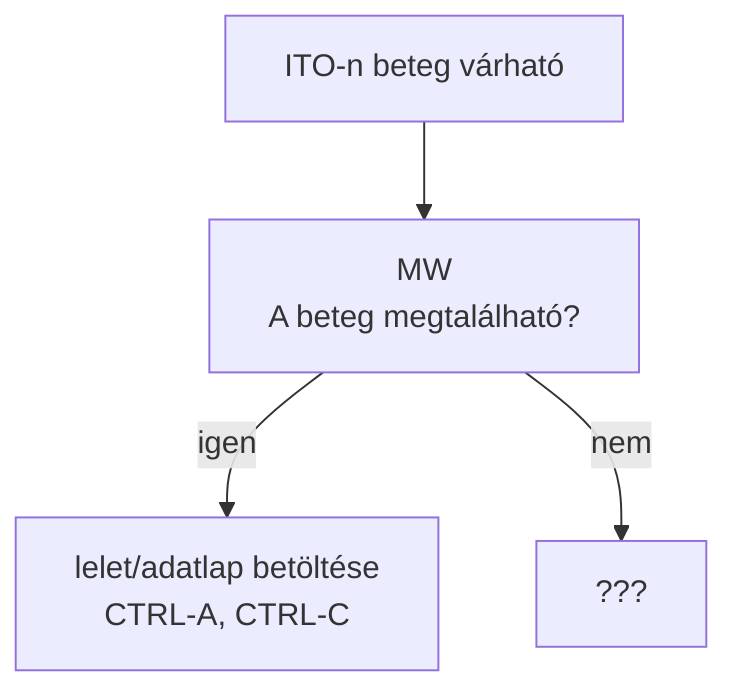

# PLAN

## Folyamat leírás

1. Megtudjuk, hogy a beteg intenzív osztályra fog érkezni
   - Belépünk a MedWorksbe, hogy lássuk az adatait
     - Ha a beteg nem található meg: ???
     - Ha a beteg megtalálható: betölteni egy leletét, vagy egy adatlapot.
   - Dokumentum látható a képernyőn
     - CTRL-A, CTRL-C: vágolapra másolás
   - A vágólapon található adatok feldolgozása
     - Név: `name`
     - Születési név: `birthName`
     - Születési hely: `pob`
     - Születési idő: `dob`
     - TAJ: `taj`
     - Anyja neve: `mothersName`
     - Lelet dátuma: `docDate`
     - Lakcím: `addr`
     - Beutaló DG: `dg0`

## Minta adatok

- Minta pdf file-ok
- Nyers torzs text adatok (pdf-ből másolva)

```text

  Észak-Pesti Centrumkórház - Honvédkórház
  1134 Budapest, Róbert Károly krt. 44.
  ÉPC-HK főigazgató: Prof. Dr. Wikonkál Norbert Miklós MTA doktora
  Hatósági egyedi azonosító: 522514
  Baleseti sebészeti szakambulancia
  Finanszírozási
  azonosító: 01K120311
  Osztályvezető főorvos: Dr. Várhelyi Levente Ph.D. orvos ezredes
  Tel.:(1)
  465-1800 / 71823 mellék
  Ambuláns lap (B0312005-J)
  Név:
  Születési név:
  Kovács Istvánné
  Tóth Margit
  Naplósorszám: 001010587
  Születési hely, idő:Szeged
  1961.11.03. ( 64 éves )
  TAJ:
  123 456 781
  Anyja neve:
  Szabó Ilona
  Vizsgálat ideje: 2026.10.21. 09:15
  Lakcím:
  1031 Budapest III. Szentendrei út 12. 2.em. 7.
  Beküldő intézet: Baleseti sebészeti szakambulancia (01K120311)
  Beküldő orvos:
  Dr. Minta Péter(O00000)
  Beutaló Dg.:
  A combnyak törése S7200
  Dg.: Fract. colli femoris l.s.

```

## Diagram


